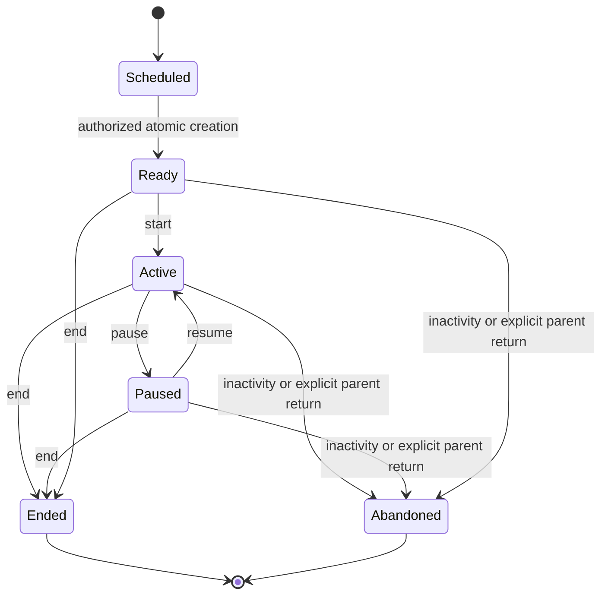
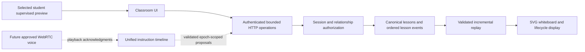

# Classroom infrastructure (Phase 5)

The functional classroom is a **supervised local classroom preview**. An authorized verified parent explicitly enters Phase 4 preview, selects a canonical reservation and opens the classroom. Maya AI, live conversation, microphone, camera, uploads and assessment are inactive. The parent must remain present. This retains parent Auth credentials and inherits the supervised-preview limitations; Return is not guardian reauthentication or unattended child access.

## Canonical context and persistence

`lessons` and `lesson_events` are reused. A rehearsal has `classroom_mode = supervised_preview`, a canonical reservation and an exact published curriculum pin copied from its persisted course plan. The UI derives course, topics, objectives, plan version, lesson position, time and duration from those records. It does not generate teaching content. Rehearsal identity/publication pins cannot be reinterpreted as instructional records, and stored preview events are append-only even for ordinary trusted writes. No competing session, whiteboard image or schedule store exists; public table count remains 43.

A future scheduled reservation may be rehearsed early. Cancelled, missed, completed and expired reservations cannot start. This is deliberately different from future live attendance eligibility. No reservation is marked completed, no course-plan position advances, and no evidence, mastery, homework or outcome is created. Application attendance excludes preview-mode rows even if their wall-clock timestamps exist. The original instructional lesson statuses remain available for existing records.

## Lifecycle

Ready and start are committed together; no intermediate browser-created record is required. One rehearsal per reservation and one open rehearsal per student are enforced by partial unique indexes. Session and student locks serialize competing starts, drawing, preview exit and lifecycle actions. An independent parent Auth session cannot mutate the open classroom. That session may read the selected student's saved rehearsal through the authorized reader.

Each changing lifecycle operation accepts a request UUID. Exact retries return the original result; conflicting reuse fails. Requests already at their requested state are no-ops without duplicate events. Pause/resume/end advance an interruption epoch, invalidating commands built against an earlier lesson state. Ended and abandoned rehearsals are terminal and read-only; use another future reservation for another rehearsal.

A visible open page heartbeats every 30 seconds. Closing/leaving the classroom preserves recovery for 15 minutes. Inactivity is reconciled on the next heartbeat, mutation or competing start, rather than by a background worker. Explicit Return to parent mode abandons an unfinished rehearsal in the same transaction as preview exit. Relationship/session revocation denies operations. A deleted Auth session does not restore parent privileges to a still-issued preview JWT.

Elapsed time is labeled **wall time**, including pauses, and is not instructional time or attendance. Disconnects do not immediately imply abandonment. The UI disables drawing while offline, replays persisted operations on reconnection and retries uncertain writes with the same command UUID.

## Whiteboard protocol v1

`features/classroom/protocol.ts` defines runtime-validated schemas. The frozen student-command JSON Schema is embedded in the additive migration and checked against Zod by tests.

An append request contains `commandId`, `expectedEpoch`, and a strict discriminated `{ kind, payload }` command. Allowed student-preview commands are:

| Kind                                             | Payload/behavior                                                                                                                                                                                                               |
| ------------------------------------------------ | ------------------------------------------------------------------------------------------------------------------------------------------------------------------------------------------------------------------------------ |
| `stroke`                                         | 2–256 normalized points in [0,1], one of three fixed colors, width 1–12. UI currently uses a dark pen at width 4.                                                                                                              |
| `erase`, `undo`, `redo`                          | Existing same-room student stroke UUID; target state is checked server-side. Eraser removes a whole stroke.                                                                                                                    |
| `clear_board`                                    | Explicit `confirmed: true`; clears visible work and redo history.                                                                                                                                                              |
| `connection_interrupted`, `connection_recovered` | Empty operational payload; available to the transport contract, never instructional evidence. The UI records recovery after a real offline interval; the disconnected indicator itself is ephemeral until contact is restored. |

The UI uses Pointer Events with pointer capture and an SVG viewBox. Mouse and actual touch input use normalized coordinates, independent of viewport size. Rendering does not load arbitrary HTML, SVG strings, URLs or scripts. Buttons and clear/end confirmations are accessible native controls. Drawing itself currently requires a pointer/touch device.

The database allocates a monotonically increasing per-lesson sequence under the student lock. Every stored preview event includes a command/event ID, protocol version, source, actor attribution internally, epoch and server timestamp. Its fingerprint makes exact command retries idempotent. The public reader projects protocol fields and omits parent actor IDs and internal fingerprints. Raw lesson events retain their original denied REST read/write policies.

Replay deduplicates deliveries, sorts by sequence and refuses gaps. The current board is derived from strokes plus visibility/clear operations; it is never persisted as repeated full images. Limits are 16 KiB per database command, 20 KB per HTTP request, 60 student events and 30 changing lifecycle operations per room/minute, and 2,990 sequence positions for new drawing/nonterminal transitions. Terminal end/abandon operations always retain reserved capacity; hitting a history limit cannot trap the parent in preview. The complete event stream is bounded to 3,000 entries. Reads return 250 events/page; the client drains up to 13 pages and polls from its last contiguous sequence. This is an operational bound, not general internet abuse/DDoS protection.

## Authenticated event delivery and future realtime

`ClassroomTransport` provides replay and close. `HttpClassroomTransport` supplies authenticated cookie-based HTTP polling every two seconds with strict response validation. `LocalReplayTransport` provides deterministic test delivery. No Supabase broadcast channel, new publication, distributed broker, external credentials or OpenAI Realtime connection is created. Current delivery is polling, with ordinary HTTP latency, not live multi-user audio/visual synchronization.

`VoiceTransport` is an unimplemented future interface. The future Maya contract supports text, math, line, shape, graph, highlight, pointer, erase and clear actions. Commands carry IDs, lesson, ordering, protocol version, Maya source, interruption epoch and an optional speech ID with start/playback-offset/end anchor. `applyMayaCommand` deterministically applies validated proposals into a scene and rejects stale/out-of-order instructions. It is not an active rendering/teaching integration.

`InstructionTimeline` releases queued visuals against acknowledged audio playback references, not LLM tool-call arrival time. Interruption increments the epoch and discards pending visuals. Phase 6 must supply trusted credentials, clock/playback acknowledgments, delivery retries, actual rendering, cancellation semantics and reviewed capability gates. A model claiming a timestamp cannot establish synchronization or authorization.

`futureEventProposalSchema` defines strict reference-only proposals for speaking/listening, questions, answers, hints, misconceptions, assessment evidence, student interruptions and media/upload requests. These require reviewed, narrowly authorized producers before activation. They are not emitted by Phase 5. Student conversation input and raw transcripts are absent.

## Authorization and disabled capabilities

The server validates Auth and selected-student preview through existing services, then verifies the URL reservation through RLS. PostgreSQL independently requires confirmed canonical PARENT role, a real owned Auth session, the private active preview and a live relationship. No parent/role/source supplied by the browser authorizes a write. Only the active room context can append or transition. Existing parent mutations and unrelated students remain denied. No ordinary service-role bypass is used.

Classroom HTTP POST additionally checks the same origin, JSON format and bounded body. Protected routes inherit private/no-store/no-referrer handling. Authenticated event URLs stay within `/preview/.../classroom/...`, so they cannot escape middleware preview scope. There are no keys, Auth session objects, parent emails, answer keys or prompts in classroom props. Logs do not record drawing or conversation content.

Microphone OFF, Camera OFF and Show Maya my work are visibly disabled. No `getUserMedia`, file input, storage bucket, upload endpoint, continuous recording or external AI call exists in the implementation. Future activation needs approved consent policy versions, guardian/access eligibility, explicit user actions, secure storage/retention and revocation handling. Independent student authentication and secure unattended handoff remain separate founder-approved designs.

## Limits and next work

The sample course contains only five skills. Polling supports one intended student/rehearsal, not a collaborative multi-participant classroom. Undo hides the newest visible student stroke; Redo restores the newest hidden stroke by original drawing order, including erased strokes. This is not an operation-level undo stack. Clear history remains durable but cannot be restored through undo. No offline drawing queue or multi-device conflict merge is enabled. A terminal rehearsal cannot restart on the same reservation; there is no deletion/retention UI or scheduled cleanup worker. Production hosting and Node 22 are not newly validated by this phase. Phase 6 will integrate the tutor and reviewed voice/whiteboard orchestration; Phase 7 owns assessment, Phase 8 homework, Phase 9 adaptation.
