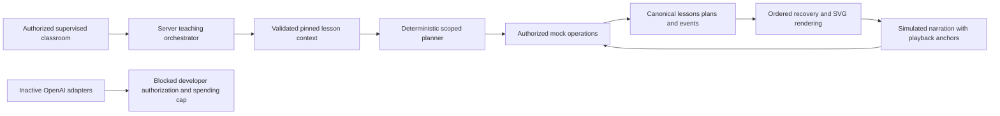

# Maya teaching integration

Phase 6 adds a functional **simulation** to the supervised classroom. It uses deterministic narration text and simulated conversation, with no audio playback, microphone, camera, uploads, external requests or paid usage. Keep the parent present. This retains Phase 4's parent credentials and supervised-return limitations.

## Architecture and context

`server/maya/orchestrator.ts` first resolves the authenticated selected student, reservation, persisted course plan and exact published enrollment pin. It builds a strict Lesson Context Package with pseudonymous student/lesson/publication references, unit/topic, planned objectives, selected skills and prerequisites, bounded published chapter guidance and evidence references. No parent identity, private assessment answers, transcripts or complete student history is loaded. Published worked examples intentionally include solution steps.

New skills remain unassessed. Existing evidence references are labeled **recorded evidence requires review**; aggregate evidence does not establish mastery against this publication. Prerequisite evidence uses the same rule. Homework contains only a bounded assignment count and a partial-read indicator. Student misconceptions and genuine summaries are explicitly unavailable to this implementation: their existing raw records lack a reviewed teaching-context contract. Phase 7/8 must establish validated interpretation and continuity. General chapter common mistakes are not observations about a student.

## Planner and teaching policy

The mock planner focuses on the first planned skill for one Grade 8 Mathematics lesson. Reviewed scripts support Integer arithmetic and Inverse operations. The first 30-minute lesson's signed-integer demonstration explains `−3 + 7 = 4`, asks why the result is positive, and offers a counter/number-line fallback. A later lesson beginning with Inverse operations demonstrates subtracting five from both sides of `x + 5 = 9`. Other first skills fail with a clear unavailable message; no unrelated demonstration is substituted.

The strict plan contains the objective, target/review skill IDs, ordered activities, worked demonstrations, questions, fallback explanations, understanding checks and null homework intent. It is validated against the pinned lesson. PostgreSQL independently derives the same plan from canonical records and frozen scripts. Only validated mock plans are persisted in `lesson_plans`; simulation plans cannot be rewritten or deleted by ordinary trusted writes.

`maya-mock-1` separates mandatory authorization/safety boundaries, global communication, mathematics pedagogy and published chapter guidance. Its activation is **simulation only**. Policy/planner/publication references are pinned with plans and `ai_runs`. Editing these code specifications requires a new reviewed version and additive compatibility migration; no mutable Teaching Studio or approved live policy is created.

## Speech and whiteboard coordination

A narration segment has a speech ID, teaching-step position, cancellation generation, bounded simulated duration and playback offset. The UI displays its text and establishes a local display clock. The server records an issued board instruction. At the offset, the browser acknowledges the pending step; PostgreSQL checks the real owned classroom session, current epoch, speech ID, time floor and canonical script before committing its typed Phase 5 Maya command. The UI renders only committed commands. Narration completion requires its duration and a committed board action.

This demonstrates **simulated segment-level coordination**, with HTTP/authorization latency. It is not spoken audio or verified word-level synchronization. A future live adapter must use actual playback acknowledgments, not provider tool-arrival timestamps or model-generated timing claims.

Interrupt advances the canonical lesson epoch. Pending old-generation acknowledgments fail. Already committed board work survives, and restarting that narration does not duplicate its applied visual. Pause/resume also invalidate pending generations through the existing lifecycle. Stop cancels the pending generation; End/Return closes or abandons the existing lesson. There is no competing lesson state machine.

Refresh replays committed state. An unfinished narration restarts its simulated display clock; it can acknowledge an unapplied action or finish an already applied action. Uncertain HTTP writes retain their UUID for exact retry. Known rejected operations require refreshed state or explicit recovery. Offline mode disables operations and retains saved work. No drawing/media merge or automatic live reconnection exists.

## Tool contract and events

Approved typed handlers are `get_lesson_context`, `get_current_objective`, `get_relevant_skills`, `get_current_board_state`, `show_whiteboard_content`, `write_whiteboard_math`, `highlight_whiteboard_region`, `ask_student_question` and `request_student_explanation`. They validate strict bounded inputs after server authorization. Read handlers return bounded context; board state includes at most 20 saved student strokes and 20 Maya objects, with partial labeling. Write handlers return proposals; they cannot directly mutate learning data. No provider can execute arbitrary function names or arguments.

The mock SQL producer applies only canonical scripted board actions. Its board-tool calls are audited in `tool_calls` and the canonical timeline. General server handlers log proposed plus validated/rejected tool outcomes through a separate tightly scoped mock audit operation before returning; rejected names are reduced to `unapproved`, without retaining raw arguments. An audit failure denies the tool. This audit endpoint does not execute a tool or authorize live AI.

Durable events distinguish simulation initialization, explanation start/completion, issued/applied board instructions, validated board tools, proposed/validated/rejected tool calls, interruption, fixed hints, simulated learner responses and stop. Sources are explicitly `maya_mock`. Operational timeline data never becomes genuine attendance, assessment, mastery, misconception, homework or schedule changes. No answer transcript or raw audio is stored.

## Limits and telemetry

Mock teaching is capped server-side at five minutes from initialization. Expiry is reconciled on the next teaching operation; idle waiting incurs zero usage. It shares the existing single open classroom per student and requires its owning signed Auth session. Mock operations and tool audits share a 60-event/minute bound, counting both events for operations that emit two. New work stops before the 3,000-event history cap, retaining capacity for Stop/End/Return. Stop remains available while the lesson is paused and bypasses the work rate limit.

`ai_runs` records the mock provider, deterministic model, exact policy/planner/publication references, zero external requests, zero estimated external cost and duration bound. Tools contain operational IDs/outcomes, not sensitive arguments. `SessionBudget` implements a tested fail-closed estimated-usage ledger with duration, operation and budget checks; it is not evidence of a provider-enforced spending cap. Unknown estimates or unverified caps deny usage. No exact live dollar cost is claimed.

## Inactive OpenAI and WebRTC adapters

Official documentation checked on October 11, 2026: [WebRTC connection and authentication](https://developers.openai.com/api/docs/guides/voice-webrtc), [Realtime conversation and interruption events](https://developers.openai.com/api/docs/guides/realtime-conversations), [Structured Outputs](https://developers.openai.com/api/docs/guides/structured-outputs), [GPT-Realtime-2.1](https://developers.openai.com/api/docs/models/gpt-realtime-2.1), and [GPT-6 Astra](https://developers.openai.com/api/docs/models/gpt-6-astra). OpenAI SDK 7.32.0 is pinned.

Server-only adapters use documented Realtime client-secret creation and Responses structured parsing. Model selection is environment-configurable within an explicit capability allowlist (`gpt-realtime-2.1` for audio, `gpt-6-astra` for structured planning). The SDK uses operation timeouts and zero automatic retries; structured calls specify `store: false`, bounded output and runtime validation. Realtime configuration allows audio, bounded generated output and no unrestricted tools. Existing supervised context is independently prohibited from external disclosure.

An unused browser WebRTC adapter supports explicit microphone opt-in, credential expiry, bounded setup/session timers, audio output, speaking/listening state, cancellation/output-buffer clearing, provider/network error cleanup, track release and no automatic reconnect. It requests audio only, never video. It does not record audio. Received function arguments are proposals; no browser event can mutate the database. No classroom UI imports or starts this adapter, and no live credential endpoint exists.

**Live activation is blocked even if configuration, a key, a parent/ADMIN role or a feature flag is supplied.** The repository lacks a trusted developer capability issuer and verified server/provider spending-cap enforcement. Ephemeral credential expiry limits connection establishment; it is not an active-session duration or dollar cap. Browser timers and output-token limits cannot guarantee total Realtime spending. The adapters have not contacted OpenAI or been tested with live audio; SDK payload/type verification and fake transport/denial tests do not establish operational live voice.

## Approval and implementation needed before live use

A reviewed developer authorization mechanism must bind local trusted development access, a confirmed developer identity, an explicitly approved synthetic/adult fixture and per-session opt-in. It must be separate from ordinary parent/student preview and ordinary ADMIN roles, reject production/public hosts, and never accept a caller-controlled flag as authorization. Do not reuse real child context.

Before activation, approve an adult-only local test scope and budget-risk policy, then implement enforceable server session leases/concurrency, provider-side termination/control, verified usage reconciliation, strict spending protection or an explicitly accepted limitation, credential revocation and a reviewed live tool producer. Preserve fail-closed behavior if any gate cannot be verified. Adding a key or changing `.env.local` alone must remain insufficient. No activation approval was requested or inferred during this phase.

Before a child pilot, founders must separately approve legal age/jurisdiction and guardian eligibility, consent wording/capability decisions, student authentication/handoff, retention/deletion/withdrawal, moderation, reporting and a staffed escalation policy. The shipped simulation's fixed scripts accept no free-form student utterances. Safety-sensitive future input must stop teaching and follow an approved adult/human escalation process; this phase does not invent an approved clinical or child-safety policy. Camera, recording and uploads remain disabled.

Phase 7 owns authoritative assessment, evidence, misconceptions and mastery. Phase 8 owns validated summaries and homework continuity. Phase 9 owns adaptive schedules. None is activated here.

## Phase 6.5 follow-up

The preceding adapter description records the Phase 6 baseline. [Adult developer integration](MAYA_DEVELOPMENT.md) now provides a separate authenticated synthetic console, server-mediated WebRTC/sideband control, validated equation proposals, playback acknowledgments, private local telemetry and fail-closed lease handling. Student preview remains mock-only. Default configuration is disabled; scoped founder approval and explicit adult opt-in remain required. Live voice and educational quality have not been verified by Stage A's fake transports. See [ADR 0012](architecture/0012-adult-development-call-control.md) and [Phase 6.5 verification](PHASE_6_5_VERIFICATION.md).

## Stage B conversational repair

The developer classroom now starts sideband/greeting only after the browser applies SDP and reports a connected peer/open channel. The `grade8-adult-v2` fixture uses teacher-selected protocol actions rather than fixed equation steps. VAD-completed spoken turns request contextual responses; validated proposals bind narration, response IDs and playback acknowledgments to dynamic board commands. Pause/resume preserves conversation and board while deadline/usage gates remain enforced. No real learning writes are enabled. [Repair verification](PHASE_6_5_TEACHING_REPAIR.md) separates fake-provider/browser results from pending audible adult validation.
