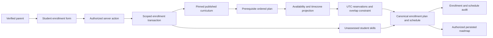

# ADR 0008 — Atomic enrollment and deterministic initial planning

**Decision:** Reuse `student_courses`, `student_skills`, `course_plans`, `course_plan_items`, `availability_preferences`, `lesson_schedules`, and `schedule_changes`. Create the complete initial state in one authenticated, narrowly scoped PostgreSQL transaction. Keep the academic plan independent from calendar projection.

**Options:** Client-directed multi-step writes; background initialization with recovery state; an atomic deterministic database operation with a server-mediated UI.

**Recommendation:** The atomic operation for this small V1 curriculum. Server services validate parent identity/ownership, publication and inputs; PostgreSQL repeats actor/relationship checks, computes the canonical plan/schedule, and commits all records or none.

**Why:** A failed reservation must not leave an enrollment that looks successful. Stable student/course uniqueness plus a student-row lock serialize competing guardians and course requests. Actor/request uniqueness and exact publication/preferences matching make retries return the same enrollment without rebuilding it. Publication and historical plan pins are retained. A changed request cannot migrate or rewrite the original schedule.

**Tradeoffs:** Planning and timezone validation run in PostgreSQL as well as pure TypeScript functions. Behavioral tests verify deterministic inputs, ordering, duration grouping, recurrence and DST. Initial projections are bounded to 200 lessons over at most two years, with a starting date in the next year. Legacy enrollments are explicitly marked `legacy`; they require reviewed initialization instead of being presented as ready. No background worker, diagnostic test, LLM or adaptive recalculation is needed.

**Reversibility:** Later workers can consume these same canonical records. Planner versions identify the heuristic; future adaptive changes append audit records and create reviewed plan versions. Stable identifiers and prior plan/curriculum pins survive.

**Skill state:** New rows have zero stored mastery/confidence, zero evidence, no evidence reference, and `unassessed`. Zero is a baseline, not observed failure or demonstrated mastery. Genuine existing skill/evidence records are preserved. Version-specific assessment requirements belong to the pinned publication; the stable student/skill row is an aggregate, not a competing curriculum version.

**Scheduling:** Parents select timezone, weekdays/time, frequency, and earliest date. Duration 30 minutes and frequency two/week are editable defaults only. Every selected weekday has one explicit time; frequency must equal slot count. UTC instants and timezone context are stored in the existing schedule table. Nonexistent and ambiguous local times are rejected. A half-open GiST exclusion constraint prevents overlapping reservations for the same student, including concurrent inserts; adjacent lessons are allowed. Existing legacy schedule rows receive a documented 30-minute end time because their schema had only a start time.

**Security:** Only confirmed canonical PARENT actors with an active relationship can enroll. Server actions and RPCs do not accept actor IDs, generated plans, mastery values or publication status. Browser table writes remain denied. Existing parent/student RLS governs reads through canonical ownership. Initial enrollment/schedule changes are audited with identifiers. Consent, AI/media and private answer restrictions remain unchanged.

**Phase 4 follow-up:** [ADR 0009](0009-application-shell-and-student-preview.md) presents these same persisted records through parent learning views and a supervised preview. Preview narrows parent-session RLS to one student and denies parent mutations. No initial plan, reservation or curriculum pin is duplicated or rewritten.
