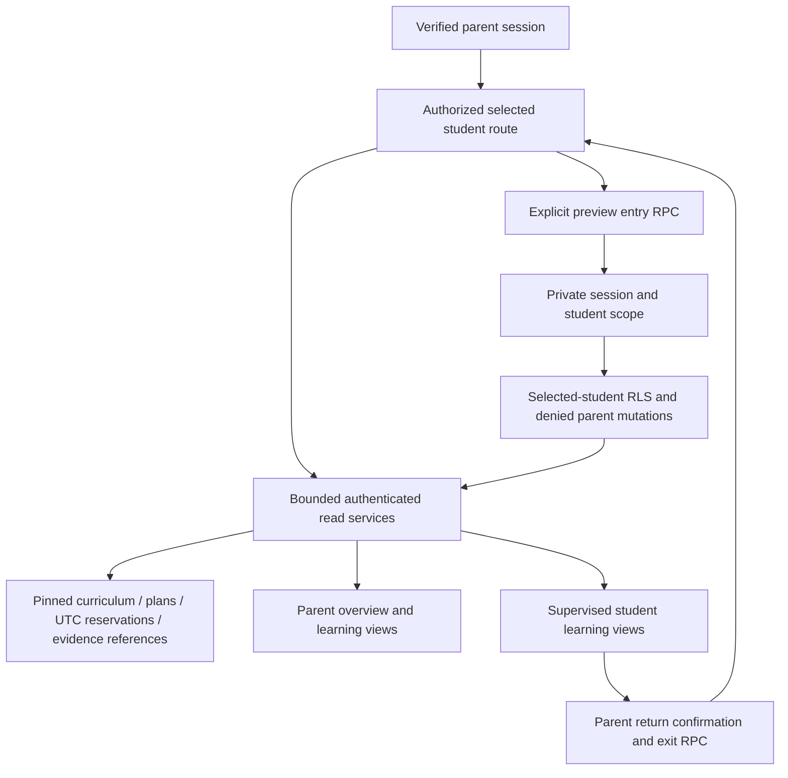

# ADR 0009 — Shared learning views and a supervised parent-assisted preview

**Decision:** Build parent Overview/Course/Progress/Homework/Schedule/Settings and student preview Home/Course/Homework/Progress over authenticated, bounded read services and canonical Phase 3 records. Selected student context lives in authorized route parameters. Preserve profile, consent, curriculum and personalized roadmap URLs.

**Options:** Duplicate dashboard state; browser-wide student state; server-authorized routes and shared view models. For student access: introduce credentials now; hide parent navigation only; narrow the current parent session in both application and database.

**Recommendation:** Shared server read models with a session-scoped supervised preview. Parent identity remains the actor. No child account, password, avatar, lesson session or learning mutation is created.

**Why:** A client selector is navigation, never authorization. The server resolves the student and exact publication pins before reading a plan. Academic facts come from immutable documents, canonical plans/reservations, skill evidence references, recorded lesson metadata and homework submission/review metadata. No mastery percentage or attention recommendation is inferred from a planned date or raw score.

**Preview boundary:** `private.parent_student_previews` binds the selected student to the signed JWT's real Auth `session_id` and canonical verified parent. It is not accessible through public REST or browser table privileges. Entry validates the current Auth session and relationship. `is_parent_of` narrows existing student/nested RLS to that student; restrictive policies hide account, consent and report data. The existing parent-mutation gate rejects preview sessions. A session lock serializes preview entry/exit and parent mutations. Directly calling learning RPCs cannot bypass these checks. Other independent sessions remain unaffected. Refresh retains scope because the Auth session identifier remains the same.

**Navigation:** Parent routes and authentication/settings actions reject or redirect active previews. Preview reads require an explicit active scope matching the route, then repeat student ownership through RLS. No sibling selector, parent settings/consent controls or administrative links appear. Returning opens a separate confirmation page; its explicit server action ends preview, audits the change and returns to that student's parent overview. Switching requires this return. Relationship revocation removes read access without silently restoring parent mode.

**Tradeoffs:** This is a supervised preview, not an unattended device handoff. The browser still holds a parent Auth session. Its explicit return control is not proof that the person pressing it is the guardian; Supabase Auth remains parent authentication, and this restriction does not replace Auth's own account/session APIs or protect against someone controlling browser credentials. Keep the parent present. Do not advertise this as an independent child login or a security kiosk. No parent token, email, session object or sibling list is supplied to preview client components. Read-only preview state is session-specific; previously rendered tabs can contain old parent data and should be closed before preview.

**Future secure handoff:** Requires an approved student-access model: guardian confirmation/reauthentication, a separate limited credential/session, removal of parent credentials from the child context, short expiry, revocation, return authentication, independent read/write scopes and reviewed child-consent/eligibility policy. Founder approval is required before enabling that workflow. It is not implemented here.

**Reversibility:** Views consume shared typed contracts; future assessed states and homework/session services can fill these without replacing academic or schedule storage. Preview access state is separate from learning data and can be retired by an additive migration. Expired-session preview rows need a reviewed operational cleanup policy; they are retained deliberately so deletion of an Auth session cannot promote an already-issued preview JWT back into parent mode.

