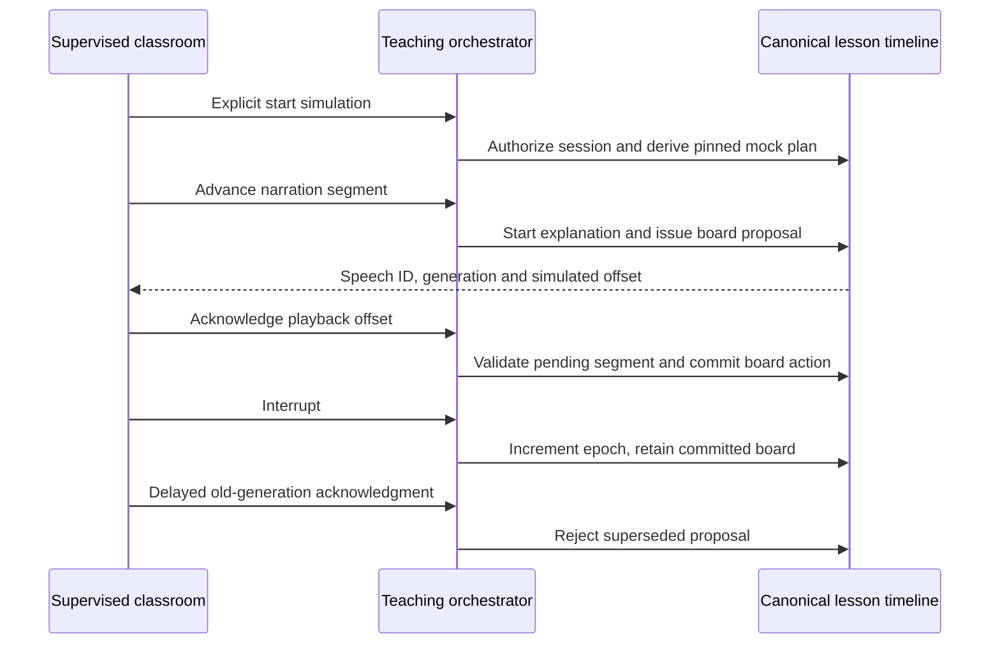

# ADR 0011 — Maya simulation on the canonical lesson timeline

**Decision:** Implement deterministic Maya teaching in supervised preview, with inactive OpenAI/WebRTC adapters behind a fail-closed live gate. Reuse canonical lessons, plans, events, policy references and operation records.

**Options:** Activate voice through parent credentials; build a disconnected browser-only demo; add a narrowly authorized durable mock producer and separate inactive live adapter.

**Recommendation:** The third option. Missing developer authorization and spending-cap enforcement preclude live activation. Parent consent drafts and ADMIN labels are insufficient.

**Why:** Mock teaching can prove context, planning, tools, ordering, cancellation and recovery without transmitting child data or incurring costs. Browser-supplied narration/board payloads would undermine trusted producer boundaries; PostgreSQL derives the bounded approved script from the pinned planned skill and validates event schemas independently.

**Tradeoffs:** Two reviewed skill scripts, simulated text rather than spoken audio, bounded event history and polling latency. Unknown/unreviewed evidence is never promoted to mastery. Existing raw misconceptions and summaries need future validated context contracts. This does not demonstrate live conversational quality or precise audio timing.

**Synchronization:** Speech references and offset acknowledgments drive canonical board commits. Interruptions increment the existing lesson epoch, reject delayed acknowledgments and preserve applied board work. Restarts do not repeat committed visuals. Media/animation stay ephemeral; simulated educational interactions create no genuine learning evidence.

**Privacy:** Authenticated RLS plus owned signed preview session gate every operation. No routine service-role bypass, private answers, raw audio/transcripts, media capture or external AI. Tool proposals have strict allowlists; canonical mock actions are independently derived and audited. Live adapters expose no public credential/proxy endpoint and deny activation even with a key/flag.

**Reversibility:** A reviewed adult-only developer capability and server-controlled live transport can later supply validated proposals to the same event stream. That requires activation approval, verifiable cost/session controls and a separate narrow producer; it must not reinterpret rehearsals as genuine lessons. New policy/schema versions need additive migrations preserving old pins.

See [Maya integration contracts and activation prerequisites](../MAYA_INTEGRATION.md).
