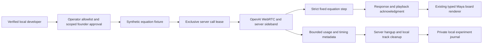

# ADR 0012 — Isolated synthetic developer experiments

**Decision:** Add a local-only authenticated adult developer console, backed by an operator-authored identity allowlist and a separately approved one-session manifest. Use server-mediated Realtime WebRTC creation, an authenticated server sideband, server termination, and the existing typed Maya board protocol and renderer. Student preview remains mock-only.

**Options:** Expose Realtime through parent credentials; send reusable ephemeral credentials to the browser; use a separate synthetic internal console with server-owned call IDs and control.

**Recommendation:** The third option. It avoids exposing real child records and prevents the application from issuing an open provider credential or proxy. A signed, confirmed, retained Auth session and local operator allowlisting are required; ordinary parent/ADMIN metadata cannot authorize access.

**Why:** The server knows the actual provider call ID before returning an SDP answer. It attaches a bounded sideband, controls response generation and validates a small equation-step allowlist before board mutation. Each narration proposal has a server-generated turn ID, provider response ID and cancellation epoch. Browser playback-start acknowledgments commit normalized commands; delayed old generations fail.

**Experiment boundary:** This is a developer call lease, not another student lesson model. No student ID, reservation, evidence or curriculum database record is accepted or loaded. The fixture is versioned code and explicitly synthetic. Existing lesson state vocabulary, command envelope, board renderer and ordering concepts are reused. The bounded local experiment journal cannot feed attendance, mastery, homework or scheduling. No canonical student store or prior migration changes.

**Limits:** One filesystem lease across local app processes; one use per approval UUID; eight generated responses, 256 output tokens/response, at most 120 seconds, 15-second heartbeat/provider-operation timeout, no automatic reconnection. Estimated usage triggers termination. Uncertain call creation or failed hangup retains the lease and blocks new calls. Process failure, untrusted manual data-channel events, telemetry delay and provider/network failures preclude a guaranteed dollar cap or guaranteed termination. Activation requires explicit acceptance of that limitation, not an assertion of a hard cap.

**Privacy:** Long-lived key and sideband remain server-only. SDP and raw conversation/media are not journaled. Synthetic board events and bounded operational metrics are stored under ignored `.local/maya` with restrictive permissions. Provider data handling remains an account-level activation prerequisite. Browser refresh recovers same-process board history and stops the existing call; it never captures or reconnects automatically. After restart, a retained lease requires reviewed provider cleanup; automatic live recovery is deliberately denied.

**Enrollment follow-up:** A demonstrated conditional loop redirected temporary Auth failures to sign-in, which can redirect a validated session back to parent. Temporary errors now fail with a retryable page/503, while missing/invalid sessions still redirect. Local opt-in timing instrumentation records only stage/status/duration. This does not establish the cause of all historically observed enrollment delays.

**Tradeoffs:** A small adult-only internal console and reviewed equation visuals; spoken mathematical quality is not guaranteed by schema checks. No child pilot, secure handoff, live moderation workflow or educational-effectiveness claim. Existing mock teaching remains independent.

**Reversibility:** Remove the developer route/gates without changing canonical learning storage. A future reviewed live student producer can reuse the protocol after consent, retention, safety, access and operational spending controls are approved.

